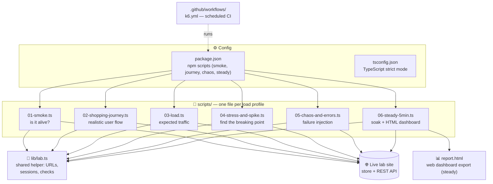

# Architecture

How this repo's folders fit together. This is a flat, focused performance-testing repo: a handful of **k6 scripts** (`scripts/`), one shared **helper** they all import (`lib/`), and config. Each script is one load profile — smoke, journey, load, stress/spike, chaos, steady — that hammers the live lab site and prints (or exports) a report. CI runs a lightweight profile on a schedule.

## Every folder, top to bottom

| Folder / file | What it is | Why it's here |
|---|---|---|
| `scripts/` | Six k6 test scripts, numbered by intensity: `01-smoke.ts`, `02-shopping-journey.ts`, `03-load.ts`, `04-stress-and-spike.ts`, `05-chaos-and-errors.ts`, `06-steady-5min.ts`. | One file per load profile. Each is run with `k6 run scripts/<file>` (see the npm scripts). |
| `lib/` | `lab.ts` — the one shared helper every script imports (base URLs, sessions, common checks and thresholds). | Keeps the scripts DRY so a change to the target or a check happens in one place. |
| `.github/workflows/` | `k6.yml`. | Runs a lightweight profile in CI on a schedule; keep heavy runs local or against a local copy. |
| `package.json` | The `npm run ...` scripts: `smoke`, `journey`, `chaos`, `steady`, `typecheck`. | The entry points — named shortcuts over `k6 run`. |
| `tsconfig.json` | TypeScript strict-mode settings. | `npm run typecheck` checks every script against it. |

> **Build outputs vs. source.** `report.html` (the steady-run dashboard export) is generated and git-ignored; it appears only after `npm run steady`. The folders you *edit* are `scripts/` and `lib/`.
